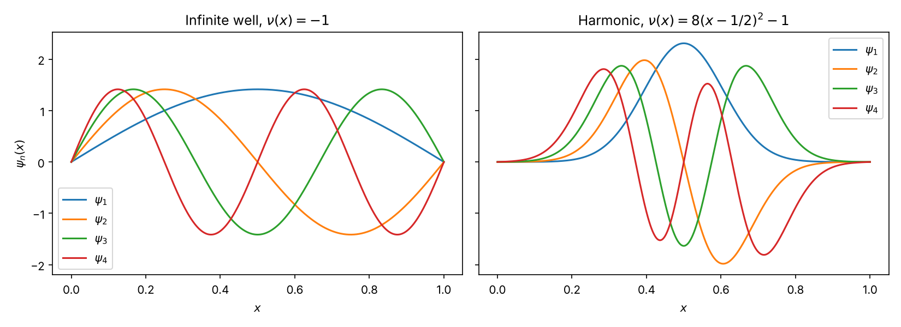
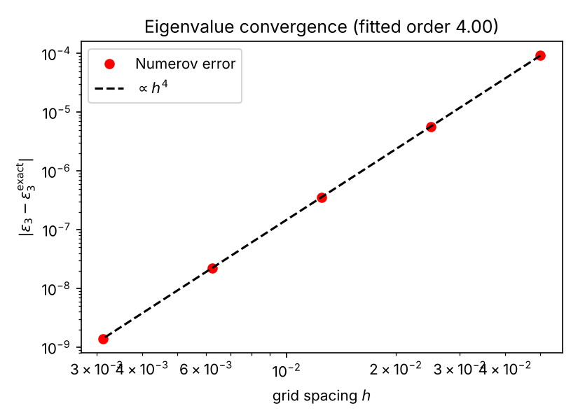
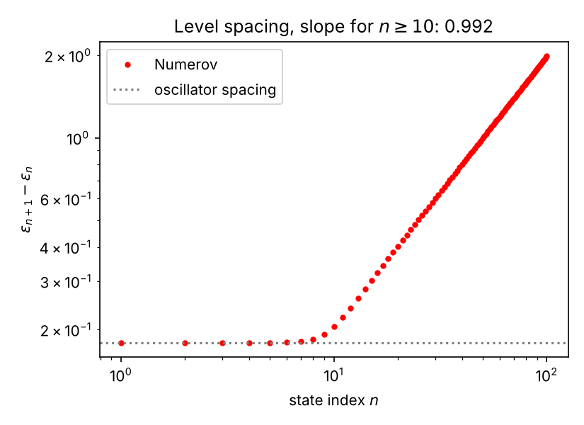
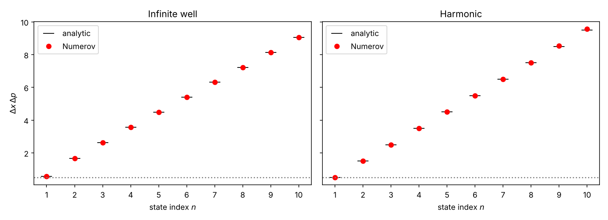
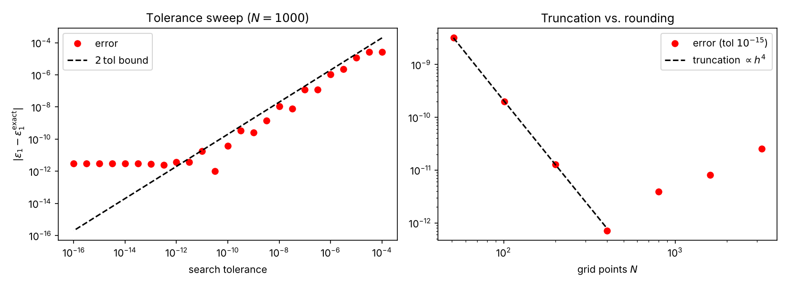

# Discrete Schrödinger Equation — Numerov shooting solver

[](https://github.com/DarkEncryption73/Discrete-Schrodinger-Equation/actions/workflows/ci.yml)

Bound states of the 1D time-independent Schrödinger equation, computed with a
fourth-order **Numerov** integrator inside a **shooting / bisection**
eigenvalue search. The solver is validated against closed-form results for an
infinite square well and a harmonic oscillator, and its convergence order is
measured rather than assumed.

**Author:** Rafael Simonsohn · **Full write-up:** [docs/report.pdf](docs/report.pdf)
(method, discussion and figures, October 2026) · **Origin:** computational-lab
coursework (see [References](#references)); this repository extends it with a
tested package, a convergence study and a precision analysis.

| Result | Value |
|---|---|
| Measured convergence order of eigenvalues | **4.00** (theory: 4) |
| Infinite well, $\epsilon_1 \dots \epsilon_{10}$, max relative error | $5 \times 10^{-9}$ |
| Harmonic, $\epsilon_1 \dots \epsilon_3$, absolute error | $< 2 \times 10^{-7}$ |
| $\Delta x\,\Delta p$ vs. analytic, max relative error | $4 \times 10^{-5}$ |
| Best attainable eigenvalue error (truncation meets rounding at $N \approx 400$) | $7 \times 10^{-13}$ |

<p align="center"></p>

---

## 1. Problem

$$-\frac{\hbar^2}{2m}\frac{d^2\psi}{dx^2} + V(x)\,\psi = E\,\psi, \qquad \psi(0) = \psi(L) = 0.$$

**Dimensionless form.** Substitute $\tilde x = x/L$, $\epsilon = E/V_0$, $\nu = V/V_0$
(rescaling removes units; divide through by $V_0$):

$$\psi''(\tilde x) + \gamma^2\big(\epsilon - \nu(\tilde x)\big)\,\psi = 0, \qquad \gamma^2 = \frac{2mL^2V_0}{\hbar^2}.$$

Write $k^2(\tilde x) = \gamma^2(\epsilon - \nu(\tilde x))$, so the equation is $\psi'' = -k^2\psi$.

Two potentials are studied on $\tilde x \in [0, 1]$:

| Case | $\nu(\tilde x)$ | $\gamma^2$ |
|---|---|---|
| Infinite square well | $-1$ | 200 |
| Harmonic well (in a box) | $8(\tilde x - \tfrac12)^2 - 1$ | 1000 |

## 2. Method

### 2.1 Numerov's recurrence

On a grid $\tilde x_i = ih$, add the Taylor expansions of $\psi_{i\pm1}$
(symmetric sum cancels odd-order terms):

$$\psi_{i+1} - 2\psi_i + \psi_{i-1} = h^2\psi_i'' + \frac{h^4}{12}\psi_i^{(4)} + O(h^6).$$

Replace $\psi^{(4)} = (\psi'')'' = -(k^2\psi)''$ by a central difference
(differentiate the ODE twice, then discretise):

$$h^2\psi_i^{(4)} \approx -\big(k^2_{i+1}\psi_{i+1} - 2k^2_i\psi_i + k^2_{i-1}\psi_{i-1}\big).$$

Substitute $\psi_i'' = -k_i^2\psi_i$ and collect terms in $\psi_{i+1}$ (linear rearrangement):

$$\Big(1 + \tfrac{h^2}{12}k^2_{i+1}\Big)\psi_{i+1} = 2\Big(1 - \tfrac{5h^2}{12}k^2_i\Big)\psi_i - \Big(1 + \tfrac{h^2}{12}k^2_{i-1}\Big)\psi_{i-1}.$$

Local error is $O(h^6)$; over $1/h$ steps it accumulates to a **global $O(h^4)$**
(errors add over $N \propto h^{-1}$ steps).

### 2.2 Shooting for eigenvalues

Start from $\psi_0 = 0$, $\psi_1 = 10^{-4}$ (the amplitude is arbitrary because the ODE is linear)
and integrate to the right wall. $\epsilon$ is an eigenvalue exactly when
$\psi(1) = 0$. The search marches $\epsilon$ upward in steps of 0.04; each time
$\psi(1)$ changes sign, the step is reversed and halved (bisection on a
bracketed root), until the step falls below the tolerance. The next search starts
just above the root it found.

### 2.3 Observables

States are normalised with Simpson's rule. With $\hbar = 1$ and $\hat p = -i\,d/d\tilde x$:

$$\Delta x = \sqrt{\langle x^2\rangle - \langle x\rangle^2}, \qquad \Delta p = \sqrt{\langle p^2\rangle} = \sqrt{-\!\int\psi\,\psi''\,d\tilde x}$$

($\langle p\rangle = 0$ for real bound states).

## 3. Analytic benchmarks

**Infinite well.** $\psi_n = \sin(n\pi\tilde x)$ forces $k = n\pi$ (boundary conditions quantise $k$), so

$$\epsilon_n = \frac{n^2\pi^2}{\gamma^2} - 1, \qquad \Delta x\,\Delta p = \sqrt{\frac{n^2\pi^2}{12} - \frac12}.$$

**Harmonic well.** Put $y = \tilde x - \tfrac12$ (shift centres the parabola):
$\psi'' + \gamma^2(\epsilon + 1 - 8y^2)\psi = 0$. This is the oscillator
$\psi'' + (\lambda - \omega^2 y^2)\psi = 0$ with $\omega = \sqrt8\,\gamma$, whose
eigenvalues are $\lambda_n = (2n-1)\,\omega$ (standard oscillator spectrum, $n \ge 1$). Matching
$\lambda = \gamma^2(\epsilon + 1)$ (equate coefficients) gives

$$\epsilon_n = (2n-1)\sqrt{\frac{8}{\gamma^2}} - 1, \qquad \Delta x\,\Delta p = n - \tfrac12.$$

This holds while the state stays well below the box walls, where $\nu = 1$.

## 4. Results

### Eigenvalues ($N = 1000$ grid points, tolerance $10^{-10}$)

| $n$ | Well (Numerov) | Well (exact) | abs. error | Harmonic (Numerov) | Harmonic (exact) | abs. error |
|---|---|---|---|---|---|---|
| 1 | −0.95065198 | −0.95065198 | 3.8e-11 | −0.91055728 | −0.91055728 | 2.3e-10 |
| 2 | −0.80260791 | −0.80260791 | 4.0e-12 | −0.73167183 | −0.73167184 | 7.7e-09 |
| 3 | −0.55586780 | −0.55586780 | 4.6e-11 | −0.55278625 | −0.55278640 | 1.6e-07 |
| 4 | −0.21043165 | −0.21043165 | 1.6e-11 | −0.37389898 | −0.37390097 | 2.0e-06 |
| 5 | 0.23370055 | 0.23370055 | 2.4e-10 | −0.19499763 | −0.19501553 | 1.8e-05 |

The well's errors sit at the bisection tolerance. The harmonic errors grow with
$n$ for a physical reason, not a numerical one: higher states reach further out,
so the hard walls at $\tilde x = 0, 1$ push them up (a test checks this).

### Convergence and uncertainty

<p align="center">
  
  
</p>

* **Convergence:** halving $h$ cuts the eigenvalue error by $2^4 = 16$; the fitted slope is 4.00.
* **Level spacing:** below the walls the harmonic spectrum is evenly spaced
  ($2\sqrt{8}/\gamma \approx 0.179$). Once $\epsilon > 1$ (around $n \approx 11$) the box
  dominates, $\epsilon_n \propto n^2$, so the spacing grows $\propto n$ (fitted slope 0.99).

<p align="center"></p>

Both potentials satisfy Heisenberg's bound $\Delta x\,\Delta p \ge \tfrac12$;
the harmonic ground state saturates it.

### Precision limits

<p align="center"></p>

* **Tolerance (left):** the final bisection bracket is narrower than twice the
  tolerance, so the error tracks the $2\,\mathrm{tol}$ bound, in steps, because the step
  halves discretely ($|\Delta\epsilon_k| = |\Delta\epsilon_0|/2^k$). Below $\mathrm{tol} \approx 10^{-12}$ it
  flattens at $\sim 3 \times 10^{-12}$ (as in Fig. 2 of the report).
* **Grid size (right):** the floor is not truncation error. Refining the grid
  reduces the error as $h^4$ only up to $N \approx 400$; beyond that, more
  steps accumulate more floating-point rounding and the error *grows*. The
  optimum ($7 \times 10^{-13}$ at $N = 401$) is where the two error sources meet.

## 5. Repository layout

```
src/schrodinger/   solver package
  numerov.py       Numerov integrator (shoot)
  eigen.py         shooting + bisection eigenvalue search
  observables.py   normalisation, Δx, Δp
  potentials.py    ν(x) for both cases
  analytic.py      closed-form benchmarks
tests/             pytest suite: eigenvalues, nodes, normalisation, Δx·Δp, convergence order, precision limits
scripts/           make_figures.py regenerates results/
results/           figures used above
notebooks/         CompLab.ipynb: the original exploratory computation
docs/report.pdf    the written report
```

## 6. Usage

```bash
pip install -e ".[dev]"
```

```bash
pytest -v
```

```bash
python scripts/make_figures.py
```

```python
from schrodinger import grid, harmonic, eigenvalues

x = grid(1000)
print(eigenvalues(3, harmonic, gamma2=1000, x=x, step=0.05, gap=1 / 200))
```

## References

1. P. Eastham, M. Mitchison and M. E. Möbius, *Numerical solution of the
   time-independent 1-d Schrödinger equation*, computational lab script (JS
   Computation Lab), 2023. Source of the problem set-up, the dimensionless
   form and the parameter choices.
2. D. J. Griffiths and D. F. Schroeter, *Introduction to Quantum Mechanics*,
   3rd ed., Cambridge University Press, 2018. Analytic eigenvalues (§2.2–2.3).
3. M. R. Roussel, *The particle in a box and the uncertainty principle*,
   lecture notes, University of Lethbridge.
4. R. Wang, *Derivative approximated by finite difference*, lecture notes,
   Harvey Mudd College.

## License

MIT, see [LICENSE](LICENSE).
